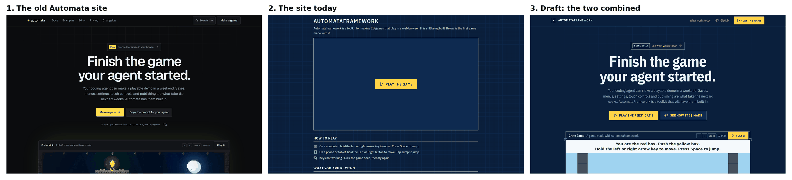
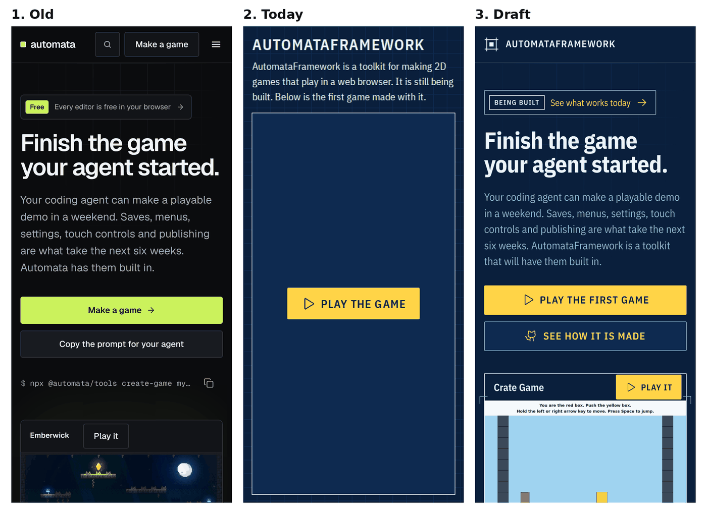
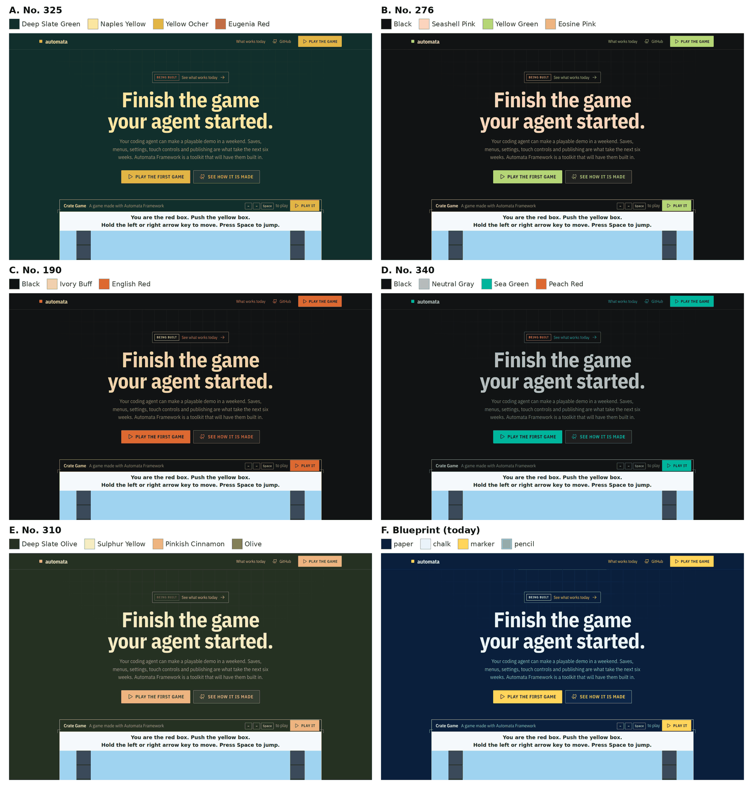
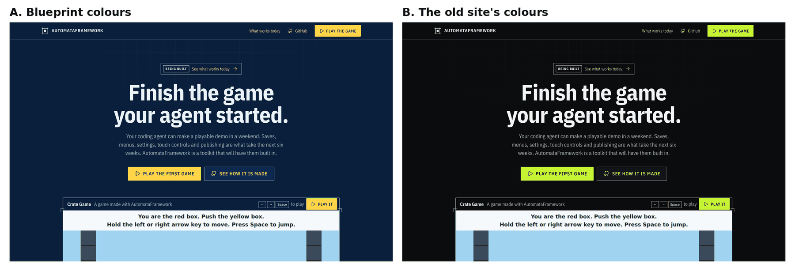

# Design audit: the home page looks unfinished

Written 2026-11-14, for `main` at `5cd631b` (the Blueprint restyle and its fixes, merged). The Owner's words: the
site "needs to be more YC coded, looks unfinished", and then "I was 90% satisfied with the old site, maybe we can
combine", the old site being the first attempt's (`site/` in AutomataFrameworkFailed, its Home in the look approved
on 2026-11-08). This audit read the pictures on `ci-screens` (`live/`, the real game, in three engines), the page's
source (`index.html`, `src/styles.css`), the old site's source, and the old site built and photographed at the same
sizes. It serves principle 1 (agent-first: the page shows the files an agent works on) and the rule that onboarding
comes first.

This is a design audit, not a stage of a running cycle: it comes before a plan. It decides nothing that is the
Owner's; the five questions at the end were his, and his answers are below.

## The answer first

The page is correct and it is not a home page yet. Everything on it is true, readable and reachable, and the Blueprint
tokens are applied faithfully. But it has no first screen: the name is set as a label, the sentence under it explains
the page instead of the product, and the largest thing a visitor sees is an empty box. Below the game there are three
sections of housekeeping and no reason to care.

The old site had exactly what this one lacks: a claim in very large type, a line under it, one bright button, the game
itself under the fold line, a row of numbers, then one section per claim with the real thing shown beside the words,
and a closing ask. It was missing what this one has: every word true today, and a look of its own.

**The direction: the old site's bones in Blueprint's skin, saying only what is true on `main` today.** A draft of it
was drawn with the site's real fonts, icons, colours and the real game's picture.

The draft's whole page: [desktop](2026-11-14-home-design/draft-desktop.png),
[phone](2026-11-14-home-design/draft-phone.png).

## The Owner's answers (2026-11-13 and 14)

Given after the first drafts. They replace the recommendations under "For the Owner" below, which is kept as it was
asked.

- **The name is "Automata Framework"**, two words, wherever a person reads it. **The logo is the word "automata"**,
  lower case, with no drawn mark (Q5: b). The drafts drawn before this answer show the old name and a drawn mark.
- **Q1, the colours: neither.** "I don't like the colors": the site takes a palette from *A Dictionary of Color
  Combinations* (Sanzo Wada). This is for the site only for now; whether the editors and the demo's screens follow is
  decided after the site. The fonts, icons, square corners and the rule that the bright colour means "you can touch
  this" stay. Five combinations were drawn, each with a dark ground, light words and one bright colour, and **the
  Owner picked A, No. 325**: Deep Slate Green for the ground, Naples Yellow for words, Yellow Ocher for what can be
  touched, Eugenia Red as the fourth colour (the stamps and small tags).

  

  | | Combination | Ground | Words | Touchable | Fourth |
  |---|---|---|---|---|---|
  | A | No. 325 | Deep Slate Green `#112f2c` | Naples Yellow `#fbe6a0` | Yellow Ocher `#e2b540` | Eugenia Red `#da525d` |
  | B | No. 276 | Black `#111314` | Seashell Pink `#fdd4bd` | Yellow Green `#afd472` | Eosine Pink `#f37f94` |
  | C | No. 190 | Black `#111314` | Ivory Buff `#ebd3a2` | English Red `#d96629` | none |
  | D | No. 340 | Black `#111314` | Neutral Gray `#b6bfc1` | Sea Green `#00b49b` | Peach Red `#f15a30` |
  | E | No. 310 | Deep Slate Olive `#253122` | Sulphur Yellow `#f5ecc2` | Pinkish Cinnamon `#eeb480` | Olive `#837e31` |

  The values are from the open data set of the book (`dictionary-of-colour-combinations` 1.0.2, MIT), read for the
  drafts and not added to the site. Two shades in each draft are not the book's: the slightly lighter panels and the
  quieter words are mixed from the ground and the words. The plan names them, holds every pair of colours a person
  reads to a contrast test, and changes `tests/styles/`, the spec's "Visual direction" (in AutomataFramework) and
  this repo's `CLAUDE.md` to say the site has its own palette.
- **Q2, the claim: (a)** "Finish the game your agent started."
- **Q3, the game before Play: (b)** the game plays its recorded play by itself on arrival, and Play hands over the
  controls. **This needs work in AutomataFrameworkExamples first**: a way for the built game to start in a "watch"
  state that replays `replays/level-1.json` with nothing drawn over it, and to take input when told to. That is its
  own cycle in that repo, and the site's plan depends on it. Until it lands, the site shows the game's real picture
  (Q3's a), so the redesign does not wait.
- **Q4, the list: (a)** all five claims, each stamped "Works today" or "Being built".

## What makes today's page feel unfinished

Each finding names where it shows. "The old site" means the first attempt's Home.

### H1. There is no first screen

- **The name is the headline.** `<h1>` is "AutomataFramework" at 32 px, in capitals, 16 px from the top of the
  window. It is the same weight and almost the same size as the section labels (20 px). Seventeen capitals in a row
  with no mark read as a file name. Nothing on the page is larger than 32 px.
- **The sentence under it apologises.** "It is still being built" is the second sentence a visitor reads, before any
  reason to stay. The old site opened with a claim (76 px, two lines) and a line that named the visitor's own
  problem.
- **The biggest thing on arrival is an empty box.** At 1440 by 900 the game's place is 930 by 520 px of flat `hatch`
  with one button; on a phone it is 80% of the screen. The most persuasive thing the project has, a real game, is
  not seen until the button is pressed. The old site showed the game's own picture at once, with one bar over it
  (the name, the keys, "Play it").
- **No top bar.** No mark, no way to GitHub without scrolling to the bottom, nothing that says "this is a site".

### H2. The type has one size

Words are 18 px, labels 20 px, the name up to 32 px: the whole scale fits inside a factor of 1.8, and everything is
left-aligned in one 928 px column, so nothing leads. The old site's scale ran 13 px (labels) to 76 px (the claim), a
factor of nearly 6, and that range is most of why it looked designed. IBM Plex Sans Condensed holds up well at 80 px
(see the draft); it needs the 700 weight, which is a file in the package the Owner already approved.

### H3. The spacing has no rhythm

Sections are 32 px apart, the same as a paragraph gap elsewhere, and every section has a full-width chalk rule under
its label, so the page reads as a form. The page ends 32 px after the footer links. The old site gave each section
128 px above and below with one quiet line between sections; the air is what made each claim feel like its own
moment.

### H4. Blueprint is only a coat of paint

The five colours, two fonts and the grid are right, but none of the drawing-table ideas from the spec's "Visual
direction" appear: no title block, no measures, no notes with leader lines, no stamp. And the grid is drawn at the
same strength across the whole page behind every word, so it reads as wallpaper rather than paper. The old site used
a grid too, but only behind the claim, fading out below it: one decoration, used once. Chalk (the brightest colour)
is used for every border, so nothing is quiet; the old site had a second, quieter line for the borders that only
divide.

### H5. The words describe the page, not the product

The three sections are "How to play", "What you are playing" and "What to do next". The first repeats what the game
itself says in its own top bar. The third's first item is "Play the game above". No section says what the toolkit is
for or why it is different. The spec's five claims, which the old site made a section each, are not on the page at
all, not even as "not yet".

### H6. There is no proof, and the proof exists

The only evidence on the page is "Game version: 05fb33d" in quiet type. Meanwhile `main` of the game's repo holds
things worth showing, all true today:

- a recorded play of 360 steps that ends at the same number (`77be68a6e1859241`) in Node, Chrome, Safari and
  Firefox, checked on every change;
- a whole level that is one small file a person can read (`content/levels/level-1.json`: walls are `#`, air is `.`);
- the fact this page already states in a paragraph: what is on GitHub is what plays here.

The old site showed the same two things as products beside the words: a file panel, and a table of engines with the
number each must end at.

### H7. Nothing moves

No hover or pressed state on the button or links beyond the browser's own, no arrival, nothing that answers a touch.
The spec gives Blueprint its "moments" (a note draws itself in over 200 ms; a stamp lands), and the old site had
small, quick motion (140 to 200 ms) on buttons and on sections as they came into view.

### H8. The page ends in a dead end

"Make your own game: not yet... this page will say when it is ready" asks the visitor to remember to come back. There
is no way to be told. The footer is two links that repeat the links above it. The old site closed with one band, one
sentence and one button, then a footer with the mark, the licence line and three short columns.

### H9. The page has no face outside itself

`<link rel="icon" href="data:,">` (an empty icon), no description, no picture for a shared link, and the tab says
only "AutomataFramework". A link to the site pasted anywhere shows as a bare address. The old site had an icon, a
touch icon, a description and a share picture.

### What is right and stays

The colours, fonts and icons; yellow only on what can be touched; 44 px targets; every sentence a drunk grandma can
read; the game never restyled and nothing drawn on it; the frame hidden until the game plays; the sideways-phone
layout; the strict safety header; no claim that is not true. None of the direction below changes these.

## What the old site got right, and what it got wrong

| The old site | Keep it? |
|---|---|
| A claim in very large type, centred, with a quieter line under it | Yes |
| A small announcement above the claim, linking to one page | Yes, saying honestly "Being built" and linking to what works today |
| One bright main button and one quiet second button | Yes; yellow is the bright one |
| The game's picture at once, under one bar: its name, the keys, "Play it" | Yes; the bar is the site's, the picture is the game's own |
| The grid only behind the claim, fading out | Yes |
| A row of four numbers read from the repo, never typed | Yes, with numbers true today |
| One section per claim: a small label, a title, a line, and the real thing beside the words | Yes, for the claims that are true today |
| 128 px of air round each section, one quiet line between | Yes |
| A closing band with one ask; a footer with the mark and short columns | Yes |
| Quick, small motion, off for people who ask for less | Yes, in the stylesheet only (see D8) |
| Near-black and lime, Geist, slightly rounded corners | No: Blueprint is the decided look (Q1 asks once) |
| Claims and sections about things `main` does not do yet (the editors, publishing, prices, 21 examples) | No: every claim on a page is true on `main` today. They come back as each becomes true |
| Search, Docs, Examples, the changelog, other pages | Not now: the site in full is M4 |
| Two motion libraries and a code-editor library | No: no new dependency is needed for this |

## The direction

One page, the same static files, the same safety header, no new dependency. In order down the page:

- **D1. A top bar.** The mark and the name on the left; "What works today", GitHub and a small yellow "Play the
  game" on the right. On a phone, the mark and the name only.
- **D2. The first screen.** Centred on a computer, left on a phone. A small "Being built" tag linking to the list of
  what works; the claim at up to 84 px, weight 700, sentence case (labels are capitals, sentences never are); one
  quieter line; "Play the first game" in yellow and "See how it is made" beside it. The grid shows only here and
  fades out.
- **D3. The game on its sheet.** One bar on top (the game's name, the keys, "Play it"), then the game's own picture
  with nothing on it, then a title block in the number font: the game's version, the level's size, the last check.
  Corner ticks outside the frame. Once the game plays, the frame's line goes, as the Owner already decided. The
  "How to play" section becomes the keys in the bar; the game says the rest itself.
- **D4. A row of numbers,** each read from the game's repo when the site is built, never typed: 4 engines, 360
  steps, 3 small files, MIT.
- **D5. "Built for agents": the level's real file** beside the words, with three drawing notes on leader lines ("A
  wall on each side", "The floor", "The yellow box"). This is the spec's drawing-notes idea used on a file, so
  nothing is drawn over the game.
- **D6. "Your agent can't quietly break your game": the recorded play's table,** one row an engine, the number each
  must end at, read from `replays/level-1.json`.
- **D7. "What works today, and what is still being built":** the spec's five claims, each with a stamp. "Works
  today" is chalk and lands slightly turned, like the spec's rubber stamp; "Being built" is a dashed pencil box.
  This replaces "It is still being built" with something a visitor can check, and keeps the rule that every claim
  is true today. **The stamps in the draft are placeholders:** the plan must hold each one to `main` with a test,
  and a claim is stamped "Works today" only when all of its sentence is true.
- **D8. Motion, in the stylesheet only:** a pressed and a hover state on every button and link; the first screen
  arrives once (200 ms); a stamp lands when its row comes into view. All of it is off under reduced motion. No
  library.
- **D9. A closing band and a real footer.** "Want to make your own game with it? Not yet. Follow the toolkit on
  GitHub and you will see the day it is ready", one button. Footer: the mark, "Free and MIT licensed", two short
  columns (the game's files, the toolkit's files, what works today, licences).
- **D10. A face outside the page:** an icon (the mark), a description, a share picture, a fuller title. All files
  the site serves itself, so the safety header does not change.
- **D11. Type and space:** sizes from 13 px (labels in the number font) to 84 px (the claim); sections 128 px apart
  on a computer and 80 px on a phone; chalk lines only round the things that matter (the game, the panels), and one
  quieter line for everything that only divides.

**What a plan must settle that this audit does not:** how the quieter line is named (the stylesheet test allows
five colours; the draft mixes pencil into paper, which the plan may do as a sixth named token with the Owner's yes, or
with `hatch`); how the game's picture is taken (CI already photographs the real game for `ci-screens`); how the
numbers and the two files reach the build without the site depending on the framework (the build already fetches the
game at a checked commit); journeys for every new part at every size, in three engines; the 404 page in the same
look.

**Not in this direction:** a features section. The Owner asked (2026-11-14) that the demo game itself show every
core feature; as the game gains them, their claims move from "Being built" to "Works today" in D7, and each can earn
its own section then.

## For the Owner

Five questions. Each has a recommendation and none is decided here.

**Q1. The colours.** The draft in both:

- (a) Blueprint: blue paper, chalk, marker yellow. Decided 2026-11-14 for the editors, the site and the demo's
  screens, so the three match. **Recommended.**
- (b) The old site's near-black and lime, on the site only. The site would no longer match the editors.

**Q2. The claim.**

- (a) "Finish the game your agent started." The old site's, with its line changed to stay true: "...AutomataFramework
  is a toolkit that will have them built in." **Recommended.**
- (b) "Your agent builds a demo in a weekend. Turning it into a game takes weeks."
- (c) Keep today's plain sentence, only larger.

**Q3. The game before Play is pressed.**

- (a) The real game's own picture, taken in CI, with nothing drawn on it; "Play it" is in the bar above it.
  **Recommended.**
- (b) The game plays its recorded play by itself on arrival, and pressing Play hands over the controls. The best
  version, but it needs work in the game's repo first and loads the whole game for every visitor.
- (c) Keep the empty sheet with the button in the middle.

**Q4. The list of what works today.**

- (a) All five claims, each stamped "Works today" or "Being built". **Recommended.**
- (b) Only the claims that work today; nothing about the rest.
- (c) No list; keep one sentence saying it is still being built.

**Q5. The mark** (the tab's icon, the top bar, the share picture).

- (a) The small drawn square with corner ticks from the draft, as a placeholder until there is a real one.
  **Recommended.**
- (b) Words only for now, and a plain yellow square as the icon, as the old site had in lime.
- (c) The Owner supplies a mark.

## How this was checked

The pictures of today's site are CI's own, from `ci-screens` at `live/` (Chromium, 1440 by 900 and 390 by 844). The
old site was built from AutomataFrameworkFailed's `main` in a cloud container and photographed with Playwright's
Chromium at the same two sizes, with reduced motion. The draft is a single hand-written page using the site's own
font files, Phosphor's regular icons, the five colours and a crop of CI's picture of the real game; it is a drawing
of the direction, not code to merge. The numbers in it (`77be68a6e1859241`, 360 steps, the 16 by 9 level, version
`05fb33d`) were read from the game's repo and from `live/`, not typed from memory. No test was run.
