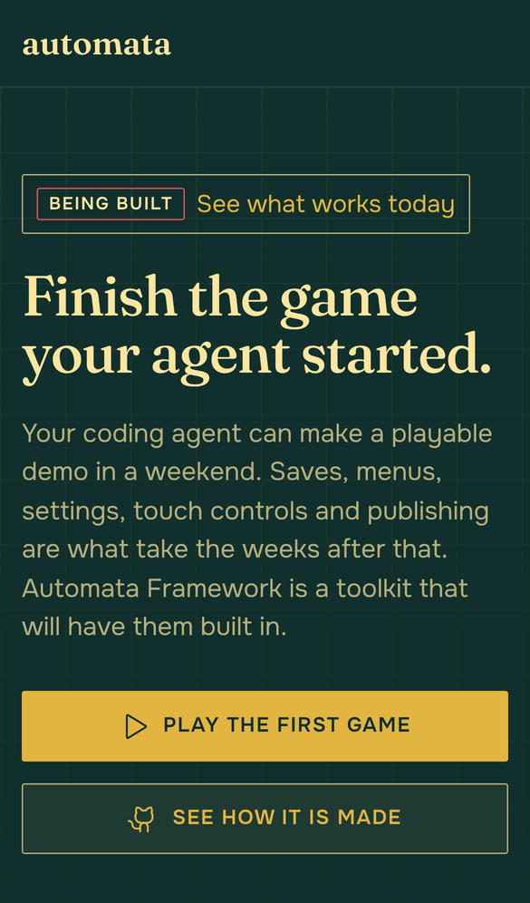
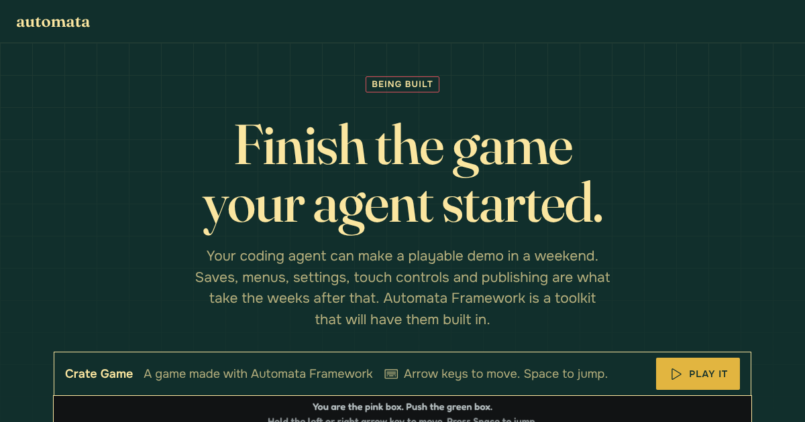
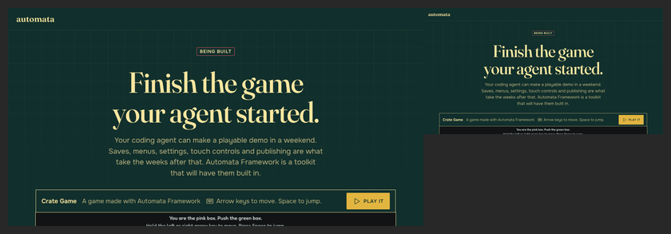
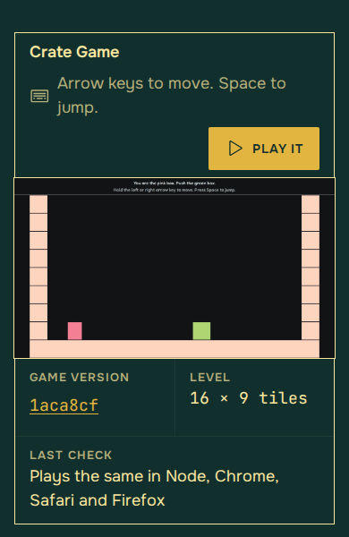
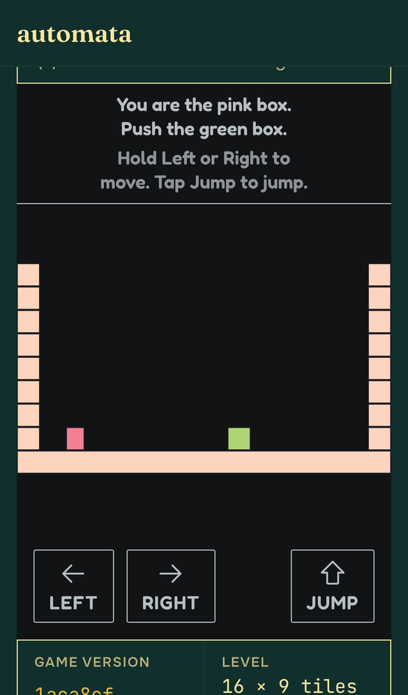
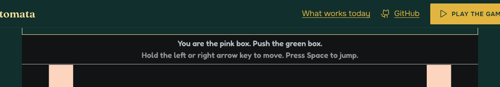

# Implementation and design audit: the home page looks finished

Written 2026-11-14. Stage 5 of Cycle 3, for [pull request 17](https://github.com/mcthaydt/AutomataFrameworkSite/pull/17)
at `4ceba86` (14 commits on `main` at `f7dd572`, not merged), read against
[the plan](../plans/2026-11-14-home-redesign-site.md) as it stands on that branch,
[its audit](2026-11-14-home-redesign-plan-audit.md), the design audit that stands in for the spec
([`2026-11-14-home-design-audit.md`](2026-11-14-home-design-audit.md): D1 to D11 and the Owner's answers), the
"Visual direction", "The offer" and "The site" sections of the
[spec](https://github.com/mcthaydt/AutomataFramework/blob/main/docs/superpowers/specs/2026-11-13-2d-first-layer-design.md)
on AutomataFramework's `main`, this repo's `CLAUDE.md` and [`progress.md`](../progress.md). It serves principle 1
(agent-first) and the rule that onboarding comes first, as the plan does.

The Owner's rulings made during execution are taken as settled and are not reopened: Lenis 1.3.27 smooths the wheel
for everyone, reduced-motion devices included, and is kept very subtle; the fonts are Fraunces, Onest and JetBrains
Mono; "Built for agents" is stamped "Being built"; the line under the claim ends "...are what take the weeks after
that."

## The answer first

**The build is what the plan asked for, and on a computer and a tablet it looks finished.** All nine tasks are there,
every number and stamp on the page is read from the game, the strict header is untouched, and all 15 checks are
green at `4ceba86`. Nothing here stops the stage.

**One thing must be put right before the merge (B1):** the pull request's own description carries a Claude credit
with a session link, which the rule forbids and the `commit-authors` check does not catch.

**Six things should be fixed in Stage 6 (F1 to F6),** three of them in the places the Owner asked to be looked at
closely:

- the share picture has a button drawn in it, and the tracker says it has none (F1);
- the stamp's landing is real but cannot be seen: it happens in the bottom 32 px of the window (F2);
- on a phone the bar that stays at the top holds only the word `automata`, and takes a tenth of the screen (F4).

**Four questions are the Owner's (Q1 to Q4)**; none is decided here and nothing waits for them but their own fix.

## The five things the Owner asked to be looked at

| | What was seen | Where it goes |
|---|---|---|
| The live first screen on a phone | It says what this is and what to press: the tag, the claim in two lines, the lede in six, two full-width buttons. On an iPhone-sized window (390 by 664 once the browser's own bars are counted) that is all of it: **no part of the game shows before a scroll**, and nothing hints there is more below. The bar at the top stays, holding only the wordmark. | F4; the rest is the Owner's eye in Stage 7 |
| The stamps landing as the cards scroll in | Only "Works today" lands (the four "Being built" boxes do not move, as planned). The landing follows the scroll and takes **32 px of scroll at the very bottom edge of the window**. One notch of a mouse wheel is 100 px. A press on "What works today" arrives with it already landed. So it is never wrong and almost never seen. | F2, Q1 |
| The share picture | The claim reads well at every size. But it shows **a yellow "Play it" button** and "Arrow keys to move. Space to jump.", and its bottom edge cuts a line of the game's own words in half. Of the game it shows a bar and a black strip: none of the level. | F1, Q2 |
| How the Lenis smooth wheel feels | It cannot be felt from a cloud session, so it was measured. One 100 px notch: 63% of the way at 80 ms, 96% at 230 ms, at rest at about 300 ms, ending exactly at 100 with no overshoot. Touch and the keyboard are the browser's own. That is subtle by any measure. A trackpad was not tried and is the place it would be felt most. | Stage 7: the Owner tries a mouse wheel and a trackpad |
| How small the game's words are in the first screen's cropped corner | The game's words are 18 px in its 1280 px picture. On a computer (the sheet is 1040 px wide) they are **14.6 px**, in the corner that shows on arrival, and read. On an upright tablet **11 px**: small, readable. On a phone **5 px**: specks, and the picture is not on the first screen at all. The tracker's "about 14 px" on a phone is the computer's figure. | F5, Q3 |

## What was asked, and the answer to each

| Check | Answer |
|---|---|
| Complete: all nine tasks, every step | Yes. Each file the plan names is there and does what its step says. The plan's boxes are all ticked and each was checked against the code, not taken on trust. |
| The plan audit's findings, B1 to B3 and S1 to S11 | All fourteen landed. S5 landed as written and has a cost the audit did not foresee (F2). S10 landed in part (F1). S1's reason does not hold on a phone (F4). |
| The Owner's answers and rulings | All kept: the name and wordmark, No. 325, the claim, the lede's ending, one "Works today" and four "Being built", the fonts, Lenis for everyone. |
| True on `main` today | Yes for the page. Every fact is `facts.json`'s, read from the game at the commit shown; the stamps come from `claims.json` and the build stops on a "Works today" whose proof fails. Two sentences in the tracker are not true (F5). |
| The game is never restyled, nothing over it | Yes. `#game` holds the picture and the frame only; the loading note and the JavaScript note are beside it. |
| The strict header | Untouched. Lenis is bundled into the page's own script; the three fonts fetched are the site's own files (`fraunces-latin-opsz`, `onest-latin-wght`, `jetbrains-mono-latin-400`: checked in a browser). |
| The drunk-grandma test | Yes on every screen read. One card contradicts itself at a glance (Q4). |
| Onboarding | Yes: what it is, what to press, and that the press worked (the page goes to the game, says "Loading the game…", then plays). A keyboard or screen-reader visitor is the exception for the page's own links (F3). |
| End-to-end tests | Yes: journeys for every part, five sizes, three engines, against the stand-in game and the real one. Three gaps: nothing looks inside the share picture (F1), nothing follows the keyboard after a link (F3), nothing holds the bar's reason on a phone (F4). |
| The codebase's own rules | Kept, with one miss: feature folders, layers in order (`motion` sits between `pictures` and `play`), one job a file, six colours and no others, exact versions, every commit by McThayDT. The stylesheet is 1,094 lines against a limit of 600 (F6). |

## Method

- The plan, its audit, the design audit, the spec's three sections and the tracker were read whole.
- Every changed source file was read at `4ceba86`: both pages, the stylesheet, `facts`, `claims`, `fill`, `pictures`,
  `motion`, `play`, `page`, the scripts, the Vite config, the layer rules, the motion journey and the lint settings.
  The other journeys were read for what they cover, not line by line.
- CI's pictures were read from `ci-screens` at `pr-17` and `pr-17-real`: arrival, whole page, playing, loading and
  not-found, at phone, tablet and computer sizes, in Chromium and WebKit, and Firefox where they differed.
- The 15 check runs of `4ceba86` were read from the pull request: all green (`live` and `deploy` skipped, as they
  are on a pull request). The `check` job's log shows **231 Node tests**; the journey counts were not recounted.
- The site was built in a cloud container around the real game (AutomataFrameworkExamples at `1aca8cf`, built with
  its own `pnpm build`), with `pnpm build` only, which the plan allows. **No test was run locally.** The built page
  was then opened in Chromium to measure what a journey does not: the share picture, the first screen at a real
  phone's window, how far a scroll the stamp's landing takes, where the page is at each frame after one wheel notch,
  which fonts are fetched, where the keyboard is after a link is pressed, and what a wheel over the playing game
  does (nothing to the page, with Lenis or on a plain page without it, so that is the game's and not new).
- The pictures in [`2026-11-14-site-redesign/`](2026-11-14-site-redesign/) are from that build.

## Before the merge

**B1. The pull request's description carries a Claude credit.** Its last lines are "Generated by Claude Code" with a
link to a session, and its task list still says "Work in progress" with eight of nine boxes empty. The rule (the
Owner, 2026-11-13) is no AI attribution in a pull request's words. `commit-authors` passed because its pattern is
"generated **with** Claude Code" and the footer the create tool adds says "generated **by**". *Fix now:* rewrite the
description (`gh pr edit 17 --body-file <file>`): the two attribution lines, what the stage did, the tracker's
deviations. *Fix in Stage 6:* the pattern in `scripts/check-commit-authors.ts` takes "with" or "by", with a case in
its test, so the next one fails loudly.

## Should fix (Stage 6)

**F1. The share picture has a button in it.** The plan (audit S10): "a picture of a button cannot be pressed", and
the card is "the wordmark, 'Being built', the claim, the lede, and the top of the game". The stylesheet hides the
bar's `nav`, the tag's link and `.actions` for the picture, and not the sheet's own "Play it", which the script has
shown by the time the picture is taken. The keys line is there too, and the picture's bottom edge falls through the
middle of the game's second line of words. The tracker's answer 10 says "no button or link drawn". *Fix:* under
`:root[data-picture="share"]` also hide `.sheet-head .btn`, `.how` and `.status`; place the cut between lines; add a
journey that sets the attribute on the page and expects no visible `.btn` or `a` with the touch colour. How much of
the game the card shows is Q2.

**F2. The stamp's landing cannot be seen.** `animation-range: entry 0% entry 100%` ends the moment the whole stamp
is inside the window (audit S5), which is right for a page at rest. Measured in Chromium at 1440 by 900: the stamp
is unseen until 10 px of it is in, and fully landed at about 42 px. A wheel moves 100 px a notch and Lenis crosses
that in a quarter of a second at the bottom edge of the window, where nobody is looking; a press on "What works
today" brings it in already landed. D7 and D8 asked for a stamp that "lands when its row comes into view". It never
shows wrongly, so this is a finish that was paid for and is not delivered, not a defect. The ways to deliver it are
Q1.

**F3. A press on one of the page's own links leaves the keyboard behind.** `motion` answers every `#` link itself
(`preventDefault`, then `reveal`). A browser's own jump also moves where the keyboard and a screen reader are; this
does not. Measured: press "What works today" in the bar, then Tab, and the focus is on "GitHub", the next thing in
the bar, not in the list the page just travelled to. A screen-reader visitor hears nothing change. *Fix:* after
`reveal(target)`, give the target the focus without scrolling (`tabindex="-1"` on the three targets, set by the
script, and `target.focus({ preventScroll: true })`), with no ring on a section; a journey presses each link, then
Tab, and expects the focus inside the target.

**F4. On a phone the bar that stays holds nothing to press.** The bar is kept at the top of the window (audit S1)
"so a Play button is always in reach", but below 700 px wide its `nav` is not shown, so on a phone the kept bar is
the word `automata` and 64 px of a 664 px window, during play as well. Beside it, at every size: a press goes to
80 px below the top and the bar is 64, so **a 16 px strip of the sheet's bar, with the bottoms of its words cut
off, shows between the top bar and the playing game.**

*Fix:* keep the bar only where it has its buttons (`min-height: 500px` and `min-width: 700px`), and give `#game` a
scroll margin of the bar's own height where the bar is kept and none where it is not, so the game sits flush. `#today`
and `.sheet` keep theirs. Journeys: on an upright phone the bar scrolls away; once playing, the game's top edge is
the bar's bottom edge (or the window's top), to the pixel.

**F5. Three statements in the tracker are not true.** (1) Answer 10: the share picture has "no button or link
drawn" (F1). (2) Answer 13: "on a phone the game's own words are about 14 px when its picture fills the width...
they read". They are 14.6 px on a computer, 11 px on an upright tablet and 5 px on a phone, where they do not read
(Q3). (3) "Node tests: 226 before the Lenis commit, plus 3": CI ran 231. *Fix:* correct the three lines when Stage 6
writes its entry.

**F6. The stylesheet is 1,094 lines; the plan's limit for a source file is 600.** It was 300 on `main`. The
architecture test that holds the limit reads only `.ts` files, so nothing failed. Two journey files are close to
it too (`look.journey.ts` 578, `home.journey.ts` 564) and Stage 6 adds journeys to both. *Fix:* split the sheet by
page part into files under `src/styles/` that `src/styles.css` imports in order (the tokens and base; the bar and
buttons; the first screen and the sheet; the parts below; other sizes; motion and the share card), with the six
colours still named in one file only; `tests/styles/` reads all of them; the 600-line rule also reads `.css`; and
the two journey files are split by what they prove before they grow.

## Minor

- **M1.** `motion.ts`'s comment explains `lerp` with "0.2 is a quick ease"; the value is 0.25. The reduced-motion
  journey is still named "nothing moves" and the next one shows the wheel is smoothed; "nothing but the wheel's
  easing moves" is the true name. The plan's Task 8 still reads "All of it in CSS; no script" and
  `scroll-behavior: smooth` with its boxes ticked; the tracker records the change, so a line in the plan pointing
  there is enough.
- **M2.** `CLAUDE.md`'s structure list still says `tests/styles/` checks "the five colours". There are six.
- **M3.** A build the site refuses (tried: a `GAME_COMMIT` that is neither a commit nor a plain word) prints its
  sentence and then a stack of 13 lines. Audit N3 asked that the sentence be the last thing printed. `orStop` calls
  `this.error`, and Vite prints the stack after it.
- **M4.** In the title block the version sits 8 px lower than "16 × 9 tiles" and the last check beside it, because
  the link is a 44 px line. Padding above and below, as `.panel-foot a` has, keeps the target and the line.
- **M5.** The numbers on a phone: "360 steps" and "3 small files" break into two lines and "4 places" and "MIT" do
  not, so the four cells have two heights of heading. One column, or `white-space: nowrap` at a smaller size.
- **M6.** The README's "To see the real game" sets `GAME_DIR` and `GAME_SOURCE` and no `GAME_COMMIT`, so that page
  says "Game version: fixture" over the real game. `GAME_COMMIT=$(git -C ../AutomataFrameworkExamples rev-parse HEAD)`
  on the same line makes it true.
- **M7.** An empty commit named "probe" (`65c3c70`) is on the branch. The tracker says so. It is harmless and will
  be in `main`'s history after the merge commit; nothing to do unless the Owner minds.
- **M8.** Lenis runs its frame loop for as long as the page is open, on touch devices too, where it smooths
  nothing (it is still what travels to a link there). Not worth a change now; worth knowing if a phone's battery or
  a slow tablet is ever looked at.

## Checked and sound

- **Facts.** `readProject` refuses what it cannot read rather than guess; a path that climbs out of the game is
  refused; a level with no things, one row, or markup in its name gives a true page (tests for each). `facts.json`
  for the real game was read: Crate Game, 16 by 9, 360 steps, `77be68a6e1859241`, three content files, MIT.
- **Claims.** The five titles are the spec's. A "Works today" with no proof, or a proof that fails, stops the
  build and names the claim. The page never says the engines "end at" the recorded number.
- **Fill.** A placeholder with words in it, an `href` of its own, or a name nobody knows stops the build; every
  value from a game is escaped once.
- **Pictures.** Playwright is loaded only inside `takePictures`; the server serves nothing outside its folder
  (tested with two climbing addresses); a game that keeps moving does not stop the build.
- **Play.** One game however many presses; the sheet's button gives way to the loading note in the same place and
  height; with JavaScript off the note is a row above the picture and no Play button shows.
- **Look.** Six colours and no seventh; the mark colour carries no words; every dividing line differs from its
  ground; sizes, capitals and families are held by journeys. On a computer and a tablet the page has one biggest
  thing a screen, air between sections, and reads as designed.
- **Motion.** The arrival runs once and ends shown; hover and press answer in 140 ms; all of it but the wheel's
  easing is off under reduced motion, as the Owner ruled. Lenis's own rule that stops pointer events on frames is
  left out on purpose, and the game keeps its pointer and its wheel.
- **Docs.** `CLAUDE.md` and the README say what the page now is, name the new dependency and its approval, and the
  Lenis notice is in `licences.txt`.
- **Commits.** All 14 are by McThayDT as author and committer; no commit message carries a credit.

## For the Owner

Four questions. Each has a recommendation; none is decided here, and nothing but its own fix waits for any of them.

**Q1. The stamp's landing (F2).**

- (a) Land it on a clock: when the "Works today" stamp is wholly in the window, it lands once over about 220 ms.
  A few lines of script in `motion` (the page already runs one), no new dependency; with no script, or reduced
  motion, the stamp is simply there. It can never rest half faded, because it does not follow the scroll.
  **Recommended.**
- (b) Leave it as built: correct, and seen by almost nobody.
- (c) Take the landing out and keep the stamp turned 3 degrees, which already reads as a stamp.

**Q2. What the share picture shows (F1 is fixed either way).**

- (a) As planned, without the button: the wordmark, "Being built", the claim, the lede, and a strip of the game
  about 40 px tall (its two lines of words, none of the level).
- (b) Leave the lede out of the picture, so about a third of the card is the game: its words and the top of the
  level. Every link preview prints the description under the picture, and it says what the lede says.
  **Recommended.**
- (c) The claim alone on the ground, with the wordmark: no game in it.

**Q3. The game's words in its picture on a phone (5 px).**

- (a) Leave it. The sheet's bar says how to play in 18 px, the playing game's own words are full size, and the
  "watch" state the Owner asked for (the game playing by itself before Play, waiting on an Examples cycle) replaces
  this picture with the real game at the phone's own size, which ends the problem. **Recommended.**
- (b) Take a second picture of the game at a phone's size and shape and show that one on a narrow window. True to
  what a phone plays, and the picture then stands 80% of the window tall before Play. Work that the "watch" state
  throws away.

**Q4. "The part after the demo is already done", stamped "Being built".** The title is the spec's, word for word.
On the card it sits just above a stamp that says the opposite, and a newcomer reads the title first.

- (a) Keep the spec's title; the stamp is the honest part, and the title becomes true when the stamp changes.
- (b) Until it is "Works today", the card's title is "The part after the demo comes built in". The spec's own
  title returns with the stamp. **Recommended.**

**For Stage 7, not questions:** the first screen on a phone is words and two buttons, with no game in sight before
a scroll. It passes the drunk-grandma test and it is not the first screen the computer gets. Showing the game there
would mean a shorter lede on a phone or a much shorter sheet bar, and both are the Owner's words and taste. The
smooth wheel should be tried by hand, with a mouse and with a trackpad.

## What happens next

B1 is fixed on the pull request as it stands (a description, not a commit). Stage 6 takes F1 to F6 and the minor
notes it agrees with, on its own branch, with the Owner's answers to Q1 to Q4 where a fix depends on one (F2 on Q1,
part of F1 on Q2). Then Stage 7, the Owner's review, with the list above.
